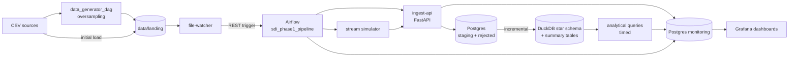

# Pharma Cold Chain DWH + BI: Phase 1 (Sales & Demand Intelligence)

An automated data-engineering pipeline for a pharmaceutical cold supply chain. **Apache Airflow** orchestrates
ingestion into **Postgres** staging, a **DuckDB** star-schema data mart, an optimised analytical query layer, and
**Grafana** pipeline-monitoring dashboards. Everything runs with **Docker Compose**.

> **Milestone 1 (this repo):** everything up to and including the Analytical Query Layer, plus the four
> Data-Engineering dashboards. The business BI dashboards are Milestone 2 (see the end of this file).

Business questions answered by the mart and query layer:

1. **Hospital forecast vs. actual consumption** ratio and **unfulfilled demand** analysis
2. **Channel revenue split and gross margin** for Retail vs. Hospital vs. E-commerce
3. **Top 10 fast-moving vs. slow-moving medicines** by therapeutic class (cold-chain highlighted)

## Architecture



Full diagram, layer table and load strategy: [docs/architecture.md](docs/architecture.md).

| Service | URL | Login |
|---|---|---|
| Airflow (UI + REST API) | http://localhost:8080 | `airflow` / `airflow` |
| Ingestion API (Swagger) | http://localhost:8000/docs | none |
| Grafana | http://localhost:3000 | `admin` / `admin` (dashboards in folder *SDI Pipeline Monitoring*) |
| Postgres | `localhost:5433`, db `pharma_dwh` | `pharma` / `pharma_pw` (Grafana uses read-only `grafana_ro`) |
| DuckDB mart | `warehouse/sdi_mart.duckdb` | file |

## Prerequisites

* Docker Desktop (Windows/macOS) or Docker Engine + compose plugin (Linux), with at least 4 GB RAM for Docker
* About 15 GB free disk space (images, Postgres volume, DuckDB file)
* Python 3.10+ only if you want to run the unit tests outside Docker
* The dataset: put the 7 CSVs (`01_master_data.csv` … `07_iot_streaming_data.csv`) in **`data/raw/`**.
  They are **not committed** (`05_pharmacy_sales_data.csv` is 218 MB, over GitHub's 100 MB limit). They come from
  the course archive `Pharma.Supply.Chain.Dataset.rar` (`tar -xf` on Windows 11 or `7z x` can extract it).

## Setup

```bash
git clone https://github.com/mugheesabid97-IBA/pharma-cold-chain-dwh-bi.git
cd pharma-cold-chain-dwh-bi
cp .env.example .env              # Windows PowerShell: Copy-Item .env.example .env
# put the 7 CSVs into data/raw/
docker compose up -d --build      # first build downloads ~600 MB of images
docker compose ps                 # wait until all 5 services are "healthy" (~2 min)
```

## Run the demo: initial load + 2 refreshes

```bash
# 1) Initial load: copies original 01, 05, 06 into data/landing/; the watcher triggers sdi_phase1_pipeline
docker compose exec airflow python scripts/initial_load.py
#    watch it in Airflow (http://localhost:8080) -> sdi_phase1_pipeline; then record evidence:
docker compose exec airflow python scripts/collect_evidence.py "Initial load"

# 2) Refresh 1 (2026-01): run the generator; its files land in data/landing/ and the watcher triggers the pipeline
docker compose exec airflow airflow dags trigger data_generator_dag --conf '{"refresh_no": 1}'
docker compose exec airflow python scripts/collect_evidence.py "Refresh 1 (2026-01)"

# 3) Refresh 2 (2026-02)
docker compose exec airflow airflow dags trigger data_generator_dag --conf '{"refresh_no": 2}'
docker compose exec airflow python scripts/collect_evidence.py "Refresh 2 (2026-02)"

# 4) Idempotency check: re-run the pipeline with nothing new -> 0 rows added
docker compose exec airflow airflow dags trigger sdi_phase1_pipeline

# 5) Documents built from the run
docker compose exec airflow python scripts/build_oversampling_report.py   # docs/Oversampling_Report.pdf
```

You can also trigger both DAGs from the Airflow UI (▶ *Trigger DAG w/ config*). `data_generator_dag` takes the
parameters `refresh_no`, `target_month` (YYYY-MM), `sources` (any of `01`…`07`), `sales_rows` and `stream_rows`.
A manual run of `sdi_phase1_pipeline` picks up every CSV in `data/landing/`. Set `SDI_PIPELINE_SCHEDULE` (e.g.
`@hourly`) in `.env` to run it on a schedule as well.

## Dashboards (Grafana, auto-refresh 15 s)

| Dashboard | Shows |
|---|---|
| **01 Batch Ingestion** | load duration per file (horizontal bar), rows loaded vs rejected per batch, **batch success rate %**, rejected rows by reason, batch log |
| **02 Streaming Ingestion** | events/sec over time, avg and p95 end-to-end latency, malformed/duplicate events per window, per-stream summary |
| **03 Storage & Staging** | donut of rows per source domain, rows per layer, table row counts, Postgres DB size, DuckDB file size, date coverage, row growth across loads |
| **04 Query Performance** | average execution time per widget **before vs after** optimisation, daily active query count, query error rate %, speed-up, per-query table |

## Data model (DuckDB `warehouse/sdi_mart.duckdb`)

* **Facts:** `fact_sales` (transaction grain) and `fact_hospital_demand` (periodic snapshot: hospital x medicine x month,
  with forecast, consumption, unfulfilled demand, `forecast_vs_actual_ratio`).
* **Dimensions:** `dim_date` (role-playing: sale / delivery / expiry date, demand month), **`dim_medicine` (conformed,
  SCD Type 2 on prices / cost / status)**, `dim_channel` (Retail / Hospital / E-commerce), `dim_pharmacy`,
  `dim_hospital`, `dim_geography` (with US region), `dim_customer_segment`, `dim_warehouse`, and junk dimensions
  `dim_sales_junk` and `dim_demand_junk`. Every dimension has an Unknown member with key -1.
* **Summary tables:** `agg_sales_month_medicine_channel`, `agg_sales_month_channel_region`, `agg_medicine_velocity`,
  `agg_hospital_demand_month`, `agg_hospital_demand_class`, `agg_hospital_unfulfilled`.
* Bus matrix, grain, measures, source-to-target mapping and validation rules:
  [docs/Phase1_SDI_Data_Model.xlsx](docs/Phase1_SDI_Data_Model.xlsx).

## Folder structure

```
├── docker-compose.yml          5 services: postgres, airflow, ingest-api, file-watcher, grafana
├── Dockerfile.airflow          slim Airflow 2.10.4 image + requirements (also used by api + watcher)
├── requirements.txt / .env.example / .gitignore
├── dags/                       sdi_phase1_pipeline.py, data_generator_dag.py (thin: they call src/)
├── src/
│   ├── config.py               all settings from environment variables
│   ├── generator/              oversampler.py (all 7 files), tasks.py (Airflow wrappers + generation_log)
│   ├── ingestion/              api.py, batch_loader.py, validation.py, stream_simulator.py, stream_ingest.py,
│   │                           watcher.py, orchestration.py
│   ├── staging/                schemas.py (single source of truth for columns/types), db.py
│   ├── transform/              runner.py (incremental DuckDB loads), dq.py (data-quality checks)
│   ├── query_layer/            catalog.py, timer.py (QueryTimer -> monitoring.query_log), runner.py
│   └── monitoring/             storage_metrics.py
├── sql/postgres/               init script, staging DDL (generated), monitoring DDL
├── sql/duckdb/                 00_schema … 60_build_summary_tables, queries/ (10 queries, before/after)
├── grafana/provisioning/       datasource + 4 dashboards (JSON, generated by scripts/build_grafana_dashboards.py)
├── scripts/                    initial_load, collect_evidence, build_* (xlsx, pdf, dashboards, DDL), profile_data
├── tests/                      pytest: validation, generator, star-schema SQL (31 tests)
├── docs/                       data profile, data model xlsx, oversampling report, architecture, evidence, …
├── data/raw | landing | stream | archive | rejected     (git-ignored)
└── warehouse/sdi_mart.duckdb                             (git-ignored)
```

## Tests

```bash
python -m venv .venv && .venv/Scripts/pip install -r requirements-dev.txt   # Linux/macOS: .venv/bin/pip
.venv/Scripts/python -m pytest -q tests            # or inside the stack: docker compose exec airflow pytest -q tests
```

## Assumptions

* **Channels:** the source only has `SalesChannel` = Physical Pharmacy | Ecommerce. **Hospital** is derived from
  `PharmacyType = 'Hospital Pharmacy'`, and **Retail** = the other physical pharmacies.
* **Cold chain:** only 3 of the 63 medicines are cold-chain (`ColdChainFlag = Y`). The top-10 fast/slow lists rank all
  medicines and show the cold-chain flag; a separate query ranks therapeutic classes for cold-chain vs ambient.
* **Ratios:** forecast-vs-actual = forecast packs / consumed packs (> 1 = over-forecast). Gross margin = net sales − COGS
  (verified on all 500k rows); margin % = margin / net sales. Aggregates recompute ratios from sums.
* **Customer dimension** = customer segment x payer type (the data has no customer ID). **Region** = US Census region of the state.
* **Refreshes:** the data covers 2023-01..2025-12, so Refresh 1 = 2026-01 and Refresh 2 = 2026-02. Each adds about 14,000
  sales (the 500k/36 monthly average; 11k batch + 3k streamed), 756 hospital rows (12 x 63) and 3 medicine price changes
  (SCD2). About 1 % deliberately bad rows are added; see [docs/Oversampling_Report.pdf](docs/Oversampling_Report.pdf).
* **Watcher** uses polling, because inotify events do not cross Docker Desktop bind mounts on Windows/macOS.
* **Airflow** runs scheduler + webserver in one container (LocalExecutor) to keep memory low on an 8 GB laptop.
* The mart is **never emptied**. Re-running any step adds no duplicates (natural-key checks + `stg_id` watermarks).

## Milestone 2: next steps

1. Build the business BI dashboards (Power BI or similar) on the DuckDB summary tables and star schema: forecast
   accuracy trend, unfulfilled-demand heatmap, channel revenue/margin split, fast/slow-mover rankings.
2. Connect through the DuckDB ODBC driver, or add an `export_parquet` task (partitioned by year/month) for BI tools.
3. Add Phase 2 facts (manufacturing, deliveries, warehouse snapshots) on the conformed `dim_medicine`, `dim_date`
   and `dim_warehouse`; the generator already supports files 02/03/04/07.
4. Add alerting (Grafana alert rules) on batch success rate < 100 %, stream p95 latency and DQ failures.

## More documentation

* [docs/data_profile.md](docs/data_profile.md): profile of all 7 source files
* [docs/run_evidence.md](docs/run_evidence.md): row counts and max dates after each load (growth + idempotency)
* [docs/query_optimisation.md](docs/query_optimisation.md): before/after timings
* [docs/VERIFICATION.md](docs/VERIFICATION.md): commands to verify everything, with the actual output
