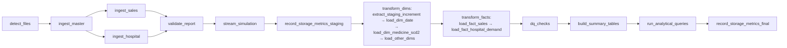

# Architecture: Phase 1 (Sales & Demand Intelligence)

```mermaid
flowchart LR
    subgraph SRC["Sources (data/raw)"]
        M["01_master_data.csv"]
        S["05_pharmacy_sales_data.csv"]
        H["06_hospital_demand_data.csv"]
        O["02/03/04/07<br/>(later phases)"]
    end

    subgraph GEN["Data Oversampling Layer"]
        G["data_generator_dag<br/>src/generator/oversampler.py"]
    end

    subgraph ING["Data Ingestion Layer"]
        L[("data/landing/")]
        ST[("data/stream/")]
        W["file-watcher<br/>(watchdog, polling)"]
        API["ingest-api (FastAPI)<br/>POST /ingest/batch<br/>POST /ingest/stream"]
        V["validation.py<br/>13 row rules"]
        SIM["stream_simulator.py<br/>25 events/s micro-batches"]
        AR[("data/archive/")]
        RJ[("data/rejected/")]
    end

    subgraph PG["Storage & Staging: Postgres 16"]
        STG["staging.stg_master_medicine<br/>staging.stg_pharmacy_sales<br/>staging.stg_hospital_demand"]
        REJ["staging.rejected_rows"]
        MON["monitoring.*<br/>generation_log, batch_ingestion_log,<br/>stream_metrics, storage_metrics,<br/>date_coverage, query_log, dq_check_log"]
    end

    subgraph DW["Transformation & Dimensional Model: DuckDB (warehouse/sdi_mart.duckdb)"]
        DIM["Dims: date (role-playing), medicine (SCD2, conformed),<br/>channel, pharmacy, hospital, geography,<br/>customer segment, warehouse, 2 junk dims"]
        FCT["fact_sales (transaction)<br/>fact_hospital_demand (periodic snapshot)"]
        AGG["6 summary tables<br/>agg_sales_month_medicine_channel, ..."]
        DQ["DQ checks"]
    end

    subgraph QL["Analytical Query Layer"]
        Q["10 queries x (before | after)<br/>QueryTimer -> monitoring.query_log"]
    end

    subgraph AF["Apache Airflow 2.10 (LocalExecutor)"]
        DAG["sdi_phase1_pipeline"]
    end

    GF["Grafana 11<br/>4 provisioned dashboards"]
    BI["Milestone 2:<br/>business BI dashboards"]

    M & S & H --> G
    O -.-> G
    G -->|"refresh CSVs"| L
    G -->|"stream replay file"| ST
    SRC -->|"initial load"| L
    L --> W -->|"Airflow REST API: trigger DAG"| DAG
    DAG -->|"ingest_* tasks"| API
    API --> V
    V -->|"valid rows (COPY)"| STG
    V -->|"invalid rows + reason"| REJ
    API --> AR
    API --> RJ
    DAG -->|"stream_simulation"| SIM
    ST --> SIM -->|"POST /ingest/stream"| API
    STG -->|"DuckDB postgres extension<br/>(stg_id > watermark)"| DIM
    DIM --> FCT --> DQ --> AGG --> Q
    DAG -.orchestrates.-> DIM
    API & SIM & G & Q & DQ -->|"metrics"| MON
    MON --> GF
    AGG -.-> BI
```

## Layers and tools

| Layer | Tool(s) | Where | What it does |
|---|---|---|---|
| Orchestration | Apache Airflow 2.10.4, LocalExecutor | `dags/` | `sdi_phase1_pipeline` (17 tasks) + `data_generator_dag` (4 tasks); retries = 2, timeouts per task |
| Data oversampling | Python, pandas | `src/generator/` | Synthesises a refresh month for any of the 7 files; ~1 % documented bad rows |
| Batch ingestion | FastAPI + pandas + psycopg2 COPY | `src/ingestion/api.py`, `batch_loader.py` | Chunked read (50k rows), validate, load valid rows, store rejects as JSON, archive file |
| Event trigger | watchdog (PollingObserver) | `src/ingestion/watcher.py` | Waits until files are stable, debounces one refresh into ONE DAG run via the Airflow REST API |
| Streaming ingestion | requests -> FastAPI | `stream_simulator.py`, `stream_ingest.py` | 25 events/s micro-batches; latency = `db_insert_ts - source_created_ts` |
| Staging / ODS | Postgres 16 | `sql/postgres/` | Typed staging tables + load metadata (`stg_id`, `batch_id`, `source_file`, `ingest_mode`, `loaded_at`) |
| Data mart / OLAP | DuckDB 1.1.3 | `sql/duckdb/`, `src/transform/` | Star schema, incremental by `stg_id` watermark, idempotent by natural-key anti-join |
| Query layer | DuckDB + timer | `sql/duckdb/queries/`, `src/query_layer/` | 3 business questions, 10 queries, before/after optimisation, timings logged |
| Monitoring | Postgres `monitoring` schema + Grafana 11.3 | `src/monitoring/`, `grafana/provisioning/` | Batch, Streaming, Storage and Query Performance dashboards (auto-refresh 15 s) |

## Pipeline DAG

## Incremental + idempotent loading

1. **Staging.** Every row carries a monotonically increasing `stg_id`. Unique indexes on the natural keys, plus the
   validation rule "duplicate PK already in staging", mean that re-ingesting a file adds 0 rows (the duplicates are
   logged as rejects).
2. **Mart.** `etl_watermark` stores the last `stg_id` processed per source. Each run copies only `stg_id > watermark`
   into `stage_inc_*`. Fact inserts also anti-join on the natural key, so even a reset watermark cannot create
   duplicates. The watermark only advances after a successful load.
3. **History.** Nothing is ever deleted. `dim_medicine` keeps every price version (SCD2), and the summary tables are
   derived data, rebuilt from the facts after every load.

## Milestone 2 hook

The business dashboards will read the DuckDB summary tables (`agg_*`) and the conformed star schema directly, for
example through the DuckDB ODBC driver in Power BI or a Parquet export. No change to the pipeline is needed.
